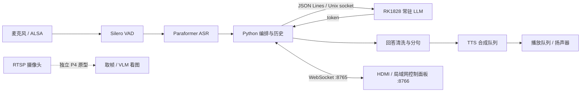

# 小揽 · youyeetoo R1 端侧语音与多模态智能体

基于 **youyeetoo R1（RK3588S）+ RM1828（RK1828）** 的本地智能体。RK3588S 负责音频、识别、合成与交互，RK1828 常驻运行 InternVL3.5-4B 的语言模型部分。当前主线是语音对话；RTSP 看图已有独立原型，统一多模态调度仍在规划中。

[交互式项目介绍与进度](https://xiaolaohu123wf.github.io/youyeetoo3588s_vlm/) · [项目进展记录](PROGRESS.md) · [Agent 说明](agent/README.md) · [技术方案](agent/docs/TECH_PLAN.md)

> 分支范围：本页描述 `codex/project-overview` 的本地语音基线。远端 `main` 另有多模态、摄像头与 GPIO 安全关机开发，尚未与该基线合并。
> 文档整理日期：2026-10-09。硬件性能与阶段验收来自仓库 2026-08 的记录，本次整理未重新执行板端测试。网页是项目介绍页，板端实时控制面板位于 `agent/ui/`。

## 当前能力

- 始终监听，Silero VAD 切分语音，Paraformer 流式识别；支持 SenseVoice 备用后端。
- C++ `llm_daemon` 常驻 InternVL3.5-4B LLM-only，JSON Lines / Unix socket 输出 token。
- Python asyncio 编排多轮对话，默认保留最近四轮，空闲十分钟清除历史。
- 回答清洗、规则快捷回复、人格兜底；Matcha / VITS 多音色、语速与音量设置。
- TTS 合成和播放队列并行，支持播放阶段语音打断。**当前正常回答在完整生成与清洗后进入 TTS，并非 token 到语音全链路流式。**
- 自动选择 FY-SP701 USB 阵列麦或 ES8388 板载音频；提供录音、回放、直通与系统状态调试。
- HDMI Chromium 控制面板、WiFi AP 局域网访问、systemd 自启动及 adb / USB 麦共存配置。

## 项目结构

```text
.
├── agent/                      # 当前主线：端侧语音智能体
│   ├── daemon/                 # C++ RKNN3 常驻 LLM 服务源码与构建片段
│   ├── orchestrator/           # Python asyncio 状态机和对话编排
│   ├── asr/                    # VAD、音频采集、Paraformer / SenseVoice
│   ├── tts/                    # 分句、文本清洗、合成与播放流水线、音色
│   ├── llm/                    # Unix socket 客户端
│   ├── audio/                  # 音频设备配置与音量映射
│   ├── api/                    # WebSocket 事件总线和音频 / 系统调试
│   ├── settings/               # 用户设置持久化
│   ├── config/                 # agent.yaml、WiFi AP 参数示例
│   ├── ui/                     # 板端实时网页控制面板与壁纸
│   ├── systemd/                # 模型、编排、GUI、USB、WiFi 启动服务
│   ├── scripts/                # Windows adb 推送、板端安装和阶段验收
│   ├── proto/                  # IPC 说明（schema 仍为规划项）
│   └── docs/                   # 架构、编译、ASR、USB 与 WiFi 文档
├── voice/                      # 早期语音原型、RKNN Session 示例与音频脚本
├── p4/                         # RTSP 取帧、448×448 预处理与 VLM 看图原型
├── rknn_InternVLM_demo/         # InternVL 视觉语言模型示例
├── rknn_Qwen3_VL_demo/          # Qwen3-VL 示例
├── canvases/                   # 路线图 / 架构 Canvas 源文件
├── docs/site/                  # GitHub Pages 项目介绍（纯静态，无构建依赖）
├── docs/whitepaper/             # 本地白皮书资料，与网页发布目录分离
├── .github/workflows/pages.yml  # 项目介绍页自动发布
├── PROGRESS.md                 # 板端阶段、历史性能和待办
├── make_demo.py                # 示例图片生成辅助工具
└── read_gguf.py                 # GGUF 文件检查辅助工具
```

本地还可能存在 `InternVL3_5-4B/`、`Qwen3-0.6B/`、`Qwen3-VL-4B/`、RKNN SDK、刷机工具与镜像。这些是运行资源，受 `.gitignore` 管理，不随源码下载。`agent/vision/` 尚未实现，不能把目录规划视为已完成能力。

## 运行架构



| 组件 | 关键入口 | 运行位置 |
|---|---|---|
| 对话编排 | `agent/orchestrator/main.py` | RK3588S，Python |
| 模型服务 | `agent/daemon/llm_daemon.cpp` | RK1828 推理，C++ 宿主进程 |
| 模型客户端 | `agent/llm/client.py` | `/tmp/r1-llm.sock` |
| 流式 ASR | `agent/asr/asr_engine.py` | RK3588S CPU / sherpa-onnx |
| TTS 队列 | `agent/tts/tts_queue.py` | RK3588S CPU / ALSA |
| 配置 | `agent/config/agent.yaml` | `/userdata/agent/config/agent.yaml` |
| 控制面板 | `agent/ui/index.html` | HTTP 8766 / WS 8765 |
| RTSP 原型 | `p4/scripts/p4_test.sh` | 独立运行，勿与语音主线争用 RK1828 |

## 阶段进度

| 阶段 | 状态 | 已记录的结果 / 下一步 |
|---|---|---|
| P0 硬件通电 | 已完成 | PCIe 识别、adb 连接 |
| P1 软件栈 | 已完成 | RKNN3 1.0.5b10；Qwen3-0.6B 约 155 tok/s |
| P2 静态看图 | 已完成 | InternVL3.5-4B / Qwen3-VL-4B 端到端示例 |
| P3 纯文本对话 | 已完成 | InternVL LLM-only 约 80 tok/s；不加载视觉部分 |
| P4 RTSP 看图 | 原型通过 | TCP 取帧与描述；stock demo 每次加载，整轮约 30 秒 |
| P5 语音智能体 | 进行中 | 常驻模型、ASR、TTS、GUI 已实现；统一 `see()` 待做 |
| P6 产品化 | 部分完成 | 自启、USB 共存、局域网控制与调试；持续稳定性待验证 |

以上性能来自历史记录，具体模型、输入和测试条件见 [PROGRESS.md](PROGRESS.md)。P4 的取帧目标为 1fps，不代表 VLM 端到端每秒完成一次描述。

后续重点：统一 VLM 常驻服务与 `see()`、启用并验证 InternVL chat template（当前 C++ 中禁用）、持久化 HugePage 配置、减少首响延迟、完善异常恢复与板端回归。

## 部署与运行

### 前提

- 板端参考环境：Ubuntu 22.04、内核 5.10.110 #12、RK1828 FW/API 1.0.5b10。
- Windows 已配置 adb；板端模型、RKNN runtime、sherpa-onnx 和音频资源就绪。
- LLM 源码需按 [BUILD_LINUX.md](agent/docs/BUILD_LINUX.md) 编译。仅推送源码无法生成可运行 daemon。
- 模型 / SDK 不在 Git 中；下载仓库后需单独准备，详见 [TECH_PLAN.md](agent/docs/TECH_PLAN.md)、[ASR_STREAMING.md](agent/docs/ASR_STREAMING.md)。

在项目根目录执行：

```powershell
# 完整本地部署：推送 agent / voice / 已准备好的模型并安装服务
powershell -File agent/scripts/push_local_deploy.ps1

# 只推送 agent 改动，再安装 / 更新自启动
powershell -File agent/scripts/push_agent.ps1
adb shell sudo bash /userdata/agent/scripts/install_autostart.sh
```

板端检查：

```bash
systemctl status r1-llm-daemon r1-orchestrator r1-agent-gui
tail -f /userdata/agent/logs/orchestrator.log
bash /userdata/agent/scripts/wifi_ap_status.sh
```

HDMI 可通过桌面图标打开。电脑连接板端热点后，按 `wifi_ap_status.sh` 显示的地址访问 `http://<板端IP>:8766/`；典型热点网关为 `10.42.0.1`。热点参数配置见 [WIFI_AP_WEBUI.md](agent/docs/WIFI_AP_WEBUI.md)。控制接口应在受信任的局域网使用。

### 板端验收

`agent/scripts/phase_a_test.sh` 至 `phase_f_test.sh` 对应模型、VAD、ASR、TTS、WebSocket 与流式 ASR 验收；`phase_3_6_test.sh` 对应 FY-SP701。部分脚本会停止 / 重启服务，应在可中断的测试时段执行。硬件恢复遵循现有说明，勿手动执行 `rknn3_startup restart`。

## 项目网页维护

静态文件位于 `docs/site/`，内容与阶段数据集中在 `docs/site/data.js`。本地预览：

```powershell
python -m http.server 8080 --directory docs/site
# 浏览器打开 http://localhost:8080/
```

推送 `codex/project-overview` 或合并后的 `main` 上的网页改动会触发 `.github/workflows/pages.yml`，只上传 `docs/site/`。README、源码、模型和白皮书不进入网站部署包。Pages 的工作流发布方式见 [GitHub 官方文档](https://docs.github.com/en/pages/getting-started-with-github-pages/using-custom-workflows-with-github-pages)。

更新进度时同时核对 `PROGRESS.md` 与 `data.js`，记录来源与日期，避免把规划项或历史性能写成最新实测结果。
